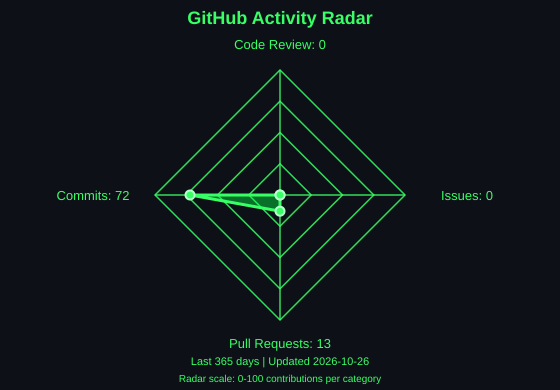

 

  

  

---

# 👋 About Me

Hi! I'm **Sri Khyathi**, with a strong interest in software development, artificial intelligence, full-stack development, databases, IoT, and cloud technologies.

I enjoy transforming ideas into practical applications and continuously improving my technical skills through hands-on projects.

### 🚀 What I Do

- 💻 Build software and full-stack applications
- 🤖 Explore Artificial Intelligence & Machine Learning
- 👁️ Work with Computer Vision
- 🗄️ Develop database-driven applications
- 🔌 Explore IoT & Embedded Systems
- ☁️ Learn and work with Cloud technologies
- 🧠 Strengthen Data Structures & Problem Solving
- 🚀 Build practical, industry-oriented projects

---

# ⚡ Technology Universe

### 💻 Software & Full Stack

  

  

### ☁️ Cloud & DevOps

  

---

# 🚀 Projects

### Building technology that solves real-world problems.

 

<table>
<tr>

<td width="50%" valign="top">

## 🤖 Enterprise AI Operations Agent

### `GenAI × RAG × AI Agents × Full Stack × Cloud`

An enterprise-oriented AI platform designed to assist with knowledge retrieval, operational requests, workflow automation, and controlled task execution through AI agents and approved tools.

### ✨ Core Capabilities

- 🤖 AI-powered operations agent
- 📚 Retrieval-Augmented Generation (RAG)
- 🧠 Enterprise knowledge retrieval
- 🔍 Context-aware question answering
- 🗄️ Database-driven information access
- 🔧 Tool and API integration
- 🎫 Operational and support workflows
- 👤 Role-based access control
- ✅ Human approval for sensitive actions
- 📝 Audit logging
- 📊 Operations dashboard
- 🔐 Secure authentication
- 🌐 REST APIs
- ☁️ Cloud-ready architecture
- 🐳 Containerized deployment

### 🛠️ Technology Stack

`Python` `FastAPI` `React` `TypeScript` `LLM` `RAG` `AI Agents` `PostgreSQL` `pgvector` `REST APIs` `Docker` `AWS`

</td>

<td width="50%" valign="top">

## 🚗 AI Pothole Recognition & Alert System

### `AI × Computer Vision × IoT`

An AI-powered road-safety system designed to detect potholes using computer vision and provide location-aware alerts for intelligent transportation applications.

### ✨ Core Capabilities

- 🎯 AI-based pothole detection
- 📷 Image and video analysis
- 🤖 YOLOv4 object detection
- 🧠 OpenCV image processing
- 📊 Confidence-based detection
- 📍 GPS-based location information
- 📡 ESP32 camera module integration
- 🚘 Vehicle safety alert mechanism
- 🔄 Road-condition monitoring
- ☁️ Location-aware alert generation
- 🗺️ Road-damage location identification
- 🔗 AI and IoT component integration
- 🛣️ Smart transportation support
- 🚧 Road-damage identification
- 📊 Detection result analysis

### 🛠️ Technology Stack

`Python` `YOLOv4` `OpenCV` `TensorFlow` `GPS` `ESP32` `IoT`

</td>

</tr>
</table>

---

# 🧩 Technical Proficiencies

| Category | Technologies |
|:---:|:---|
| 💻 Programming | Python · Java · C · C++ · JavaScript |
| 🌐 Full Stack | React · Spring Boot · Django · Flask |
| 🎨 Frontend | HTML · CSS · JavaScript |
| 🗄️ Database | SQL · PL/SQL · Oracle · MySQL · DBMS |
| 🤖 AI / ML | YOLO · TensorFlow · OpenCV |
| 🔌 IoT / Embedded | ESP32 · GPS · Arduino UNO · Raspberry Pi · Radar Sensors · IoT |
| ☁️ Cloud | AWS · Azure · GCP |
| ⚙️ DevOps / IaC | Terraform |
| 🔗 Backend | REST APIs |
| 🧠 CS Fundamentals | DSA · OOP · SDLC · Problem Solving |
| 🛠️ Tools | Git · GitHub · VS Code · Linux |

# ⚡ Technology Focus

---

# 🧠 Core Interests

🤖 **Artificial Intelligence**

💻 **Software Development**

🌐 **Full Stack Development**

👁️ **Computer Vision**

🗄️ **Databases & SQL**

🔌 **IoT & Embedded Systems**

☁️ **Cloud Computing**

🚀 **Real-World Applications**

---

# 🤝 Connect With Me

  

 

---

# 📊 GitHub Activity Studio

🌿 Code smarter. Build consistently. Keep growing.

---

